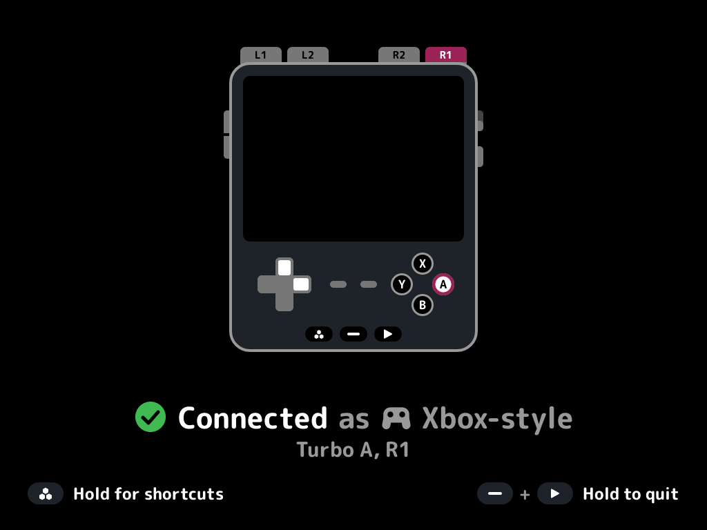
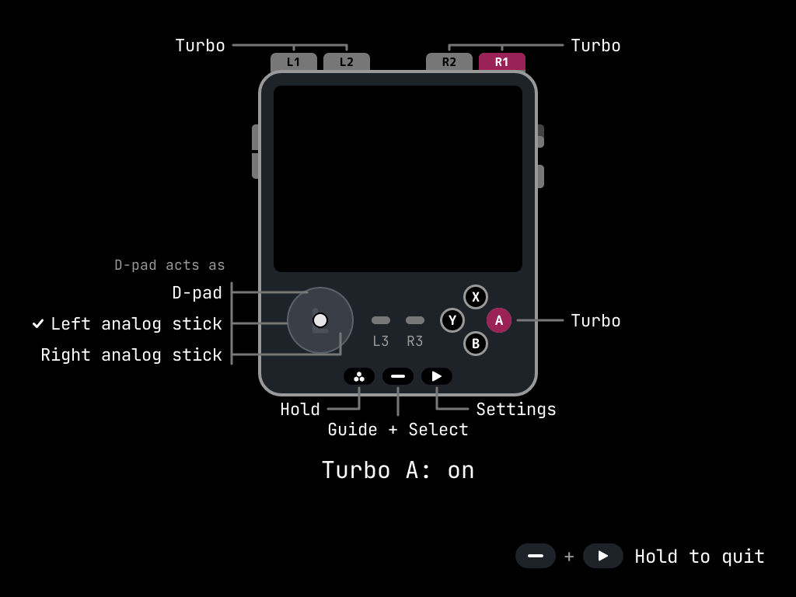
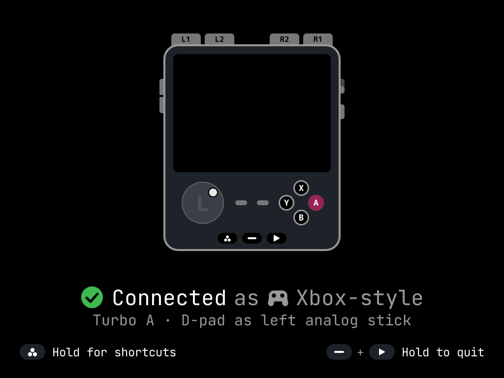
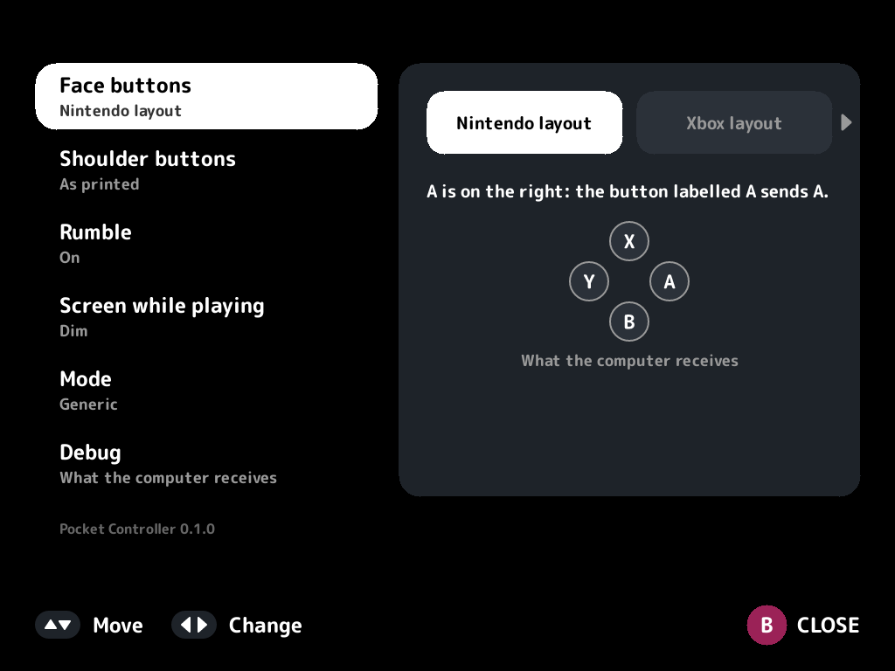

# Pocket Controller

Pocket Controller turns a Linux handheld into a wired USB controller for a computer. Nothing to install on the computer.

So far it has only been tested on the TrimUI Brick running NextUI. Other devices are packaged but untested: see [Supported devices](#supported-devices).

| Connected | Shortcuts (hold MENU) |
| --- | --- |
|  |  |
| **D-pad as an analog stick** | **Settings** |
|  |  |

pocket-controller turns the handheld's USB port into a USB device through the kernel's gadget framework (configfs and FunctionFS) and forwards the built-in controller to it.

## Modes

- **Automatic** (default): starts as Xbox-style. If no Xbox driver answers within two seconds, it switches to Generic. Unplugging tries Xbox-style again for the next computer.
- **Xbox-style**: emulates an Xbox 360 controller, with Microsoft's IDs and protocol. Linux (`xpad`) and Steam recognise it without setup.
- **Generic**: a standard USB HID gamepad that most hosts accept without drivers, including Windows, macOS and Android. Games may need you to map its buttons once.

Change the mode in settings. Quit by holding SELECT + START, pressing POWER, or pressing B while no computer is connected.

## Shortcuts

Tap MENU to send Guide. Hold MENU to see the shortcuts on screen:

- MENU + A, B, X, Y, L1, L2, R1, R2: turbo on that button.
- MENU + START: settings.
- MENU + up, left or right: the D-pad acts as the D-pad, the left analog stick or the right analog stick.

## Settings

Open settings with MENU + START, or with A while no computer is connected:

- Face buttons: Nintendo layout (the button labelled A sends A, the default) or Xbox layout (the bottom button sends A, whatever is printed on it).
- Shoulder buttons: as printed (L1 and R1 send LB and RB, the default) or swapped (L2 and R2 send LB and RB, L1 and R1 send LT and RT).
- Rumble: on or off.
- Screen while playing: dim (the default), stay on, or turn off, 30 s after a computer connects.
- Mode: Automatic, Xbox-style or Generic. Changing it while connected makes the computer see the controller unplug and replug.
- Debug: what the computer receives, live.

## Supported devices

| Device | Firmware | Status |
| --- | --- | --- |
| TrimUI Brick | NextUI | Tested |
| TrimUI Smart Pro, Brick Pro | NextUI | Expected to work, untested |
| TrimUI Brick, Smart Pro | Stock | Expected to work, untested |
| TrimUI Smart Pro S | NextUI | Untested |
| Anbernic H700 devices | NextUI | Untested |

### TrimUI Brick

- Use the bottom USB-C port. The top port is host-only.
- Connect it to a USB-A port on the computer, or through a USB-C to USB-A adapter or hub. With a USB-C to USB-C cable, laptops make the Brick the power source and nothing connects.

## Install

- NextUI: copy `Pocket Controller.pak` into `Tools/<platform>/` on the SD card, or unzip `Pocket.Controller.pak.zip` there.
- Stock TrimUI firmware: copy `PocketController` into `Apps/` on the SD card.

While it runs, the handheld's ADB gadget is set aside and restored exactly when pocket-controller quits. If pocket-controller crashes, the next start restores it, and so does a reboot.

## Development

```
nix develop
just check
just pak
just deploy
just e2e
```

`just e2e` needs the handheld on its device port, reachable over SSH (`POCKET_CONTROLLER_HOST`, `POCKET_CONTROLLER_SSH_KEY`), and connected to this computer.

`pocket-controller-probe` reports which endpoint layouts a device's USB device controller can bind, for porting to new devices:

```
pocket-controller-probe int-in:32 int-out:32
```

`just screenshots` redraws `docs/screenshots/` on this computer, with no handheld needed.

### Releasing

`just release-create 0.2.0` sets the version in `Cargo.toml` and `pak.json`, writes `CHANGELOG.md` from the Conventional Commits since the last tag, pushes `main` and tags `v0.2.0`. The GitHub mirror runs CI on the tag, then publishes a release with `Pocket.Controller.pak.zip`, `PocketController-trimui-stock.zip` and `SHA256SUMS`.

The NextUI Pak Store reads `pak.json` from the root of `main` on GitHub once an hour and downloads `releases/download/<version>/<release_filename>`. The listing breaks if `pak.json` moves, if `release_filename` stops matching the uploaded zip, or if the zip stops holding the pak's contents at its root.

## License

AGPL-3.0-or-later. The Xbox 360 and HID protocol details follow [JukaHub](https://github.com/jukaLang/JukaHubV2)'s controller mode.
